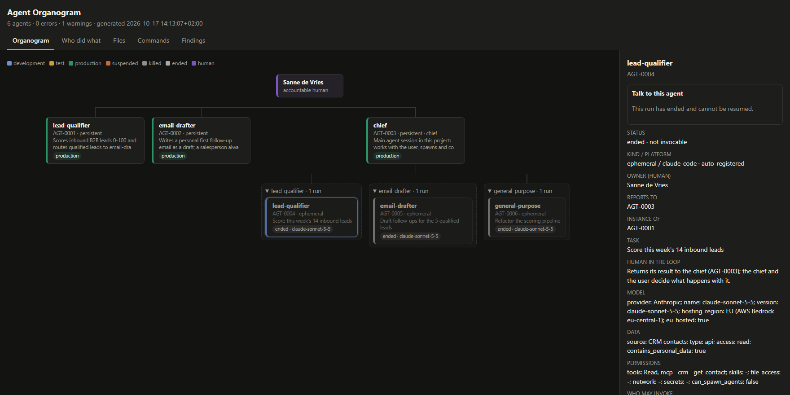
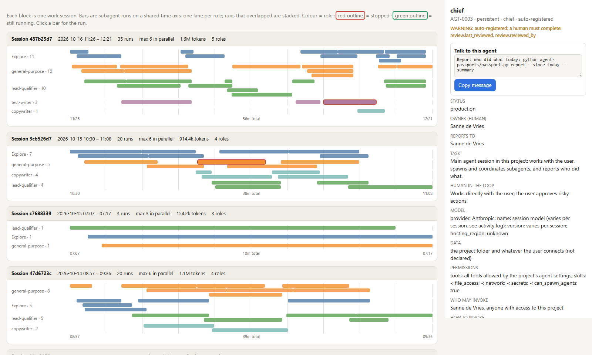
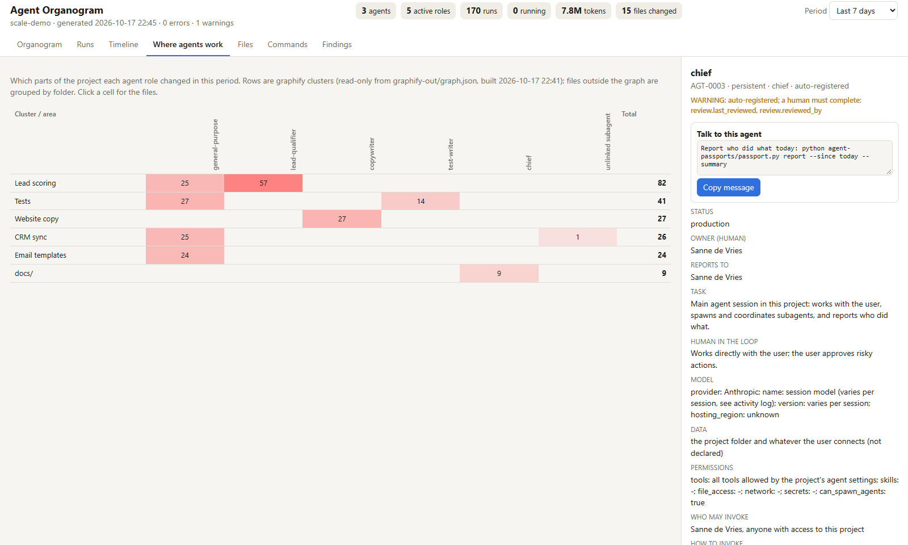
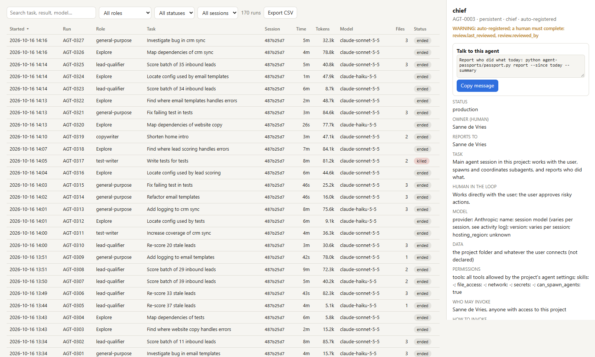
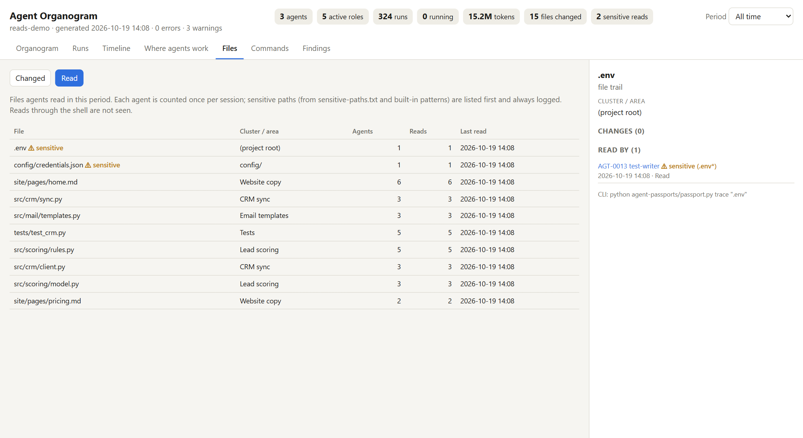

# Agent Passport

**Every agent gets a passport. No passport, no production.**

An agent skill that gives every AI agent and subagent a passport, registers subagents automatically, keeps a
hash-chained audit trail of which agent changed which file, ran which command or touched which external system,
and renders it all as an organogram. Built for audits (ISO/IEC 42001, ISO/IEC 27001, NEN 7510, EU AI Act) and for
multi-agent projects where agents need to know who they can talk to.

> **Not a certified compliance tool.** Agent Passport is a governance aid for your AI agent harness. It is not
> endorsed, certified or designated by ISO, NEN or any certification body, and using it does not make you
> compliant with ISO/IEC 42001, ISO/IEC 27001, NEN 7510 or the EU AI Act. What it does is keep an organised record
> of your agents and what they did, which you can use as supporting evidence in audits next to your own process.

## Install

```bash
npx skills add Biite-marketing/agent-passport -g
```

Works with any agent that supports skills (Claude Code, Cursor, Codex, Gemini CLI, Copilot and more).
`-g` installs it for all your projects; leave it out to install it in the current project only, or add
`-a claude-code` to pick specific agents. While the repository is private, you need read access to it.

### Monitor every project automatically (Claude Code)

Installing the skill teaches your agents the rules. To have *every* project start its own register on its first
agent activity, without setting anything up per project, install the hooks once at user level:

```bash
python ~/.claude/skills/agent-passport/scripts/passport.py install-hooks --global
```

Each project then gets its own `agent-passports/` folder the first time an agent works in it. Agent IDs
(`AGT-0001`, ...) are per project. To skip a project, put an empty `.no-agent-passports` file in its root;
`PASSPORT_DISABLE=1` pauses it everywhere; `install-hooks --global --remove` turns it off. Projects that have
their own passport hooks keep using those, so nothing is logged twice.

Requirements: Python 3.8+ (standard library only). Automatic registration uses Claude Code hooks; other platforms
register agents with two commands (`spawn` / `end`).

## What it does

- **Passports** for persistent agents and every subagent run: task, model and version, hosting region, data
  sources, permissions, owner, who it reports to, human-in-the-loop rule, kill switch, review history.
- **Three rules, checked by a validator:** no passport, no production · every model or data change updates the
  passport (fingerprinted) · quarterly human review.
- **Automatic registration (Claude Code):** hooks create a passport for every spawned subagent, record the model it
  actually used, its tokens and result, and close it when it ends.
- **Audit trail:** file changes made with the edit tools (with SHA-256), shell commands and MCP actions are tied to
  the agent that did them, in a hash-chained log. `trace <file>` shows who changed what. `verify` checks the chain
  and compares it with anchors: it detects edits, and with an anchor stored outside the project
  (`PASSPORT_ANCHOR_FILE` / `PASSPORT_ANCHOR_URL`) also a rewritten, truncated or deleted log. Direct edits to
  the log are blocked by a hook.
- **Reads:** which files, searches and web pages agents looked at (never the contents), once per agent and
  session, with sensitive paths (`.env`, keys, anything in `sensitive-paths.txt`) always logged and flagged.
  `validate` warns when an agent reads a sensitive path its passport doesn't cover.
- **What it is not:** a certified compliance product. It does not see reads or changes done through the shell
  (a script, `cat`, `sed -i`), only through the agent's own tools, and not work outside hooked tools. It records declared permissions but doesn't enforce them, and
  reviewer names are self-declared. See `references/audit.md` for the full list of limits.
- **Size:** tested up to about 5,000 subagent runs per project. Beyond that, start a new `agent-passports/`
  folder per period or workstream and keep the old one as the archive.
- **Graphify link (read-only):** if the project has `graphify-out/graph.json`, every changed file shows its graph
  cluster and connected files. The skill never writes to `graphify-out/`.
- **Organogram:** `agent-passports/registry.html` shows humans, the chief (main session), agents and subagent
  runs. Click an agent for its passport and a ready-to-paste message to address it. There are tabs for
  *Who did what*, *Files* (changed or read), *Commands* and *Findings*.

## Screenshots

Examples from a fictional demo project.

Examples from a fictional busy project: one chief, 324 subagent runs over 10 days.

**Organogram**: structure first. Runs are folded into one card per subagent role, with counters for the selected period.



**Timeline**: one block per work session. Each role gets a lane, parallel runs are stacked, and stopped runs are outlined in red.



**Where agents work**: graphify clusters (or folders) against agent roles. It shows which parts of the project each role changed.



**Runs**: a searchable, sortable table with CSV export. Click a run for its full trail: task, model, files with hashes, commands and result.



**Reads**: the Files tab switches between changed and read. Sensitive paths come first, with the agent that read them.



A period selector (24 h · 7 days · 30 days · quarter · all) applies to every view. Deep links such as `registry.html#time`, `#map`,
`#AGT-0042` or `#file=src/scoring.py` open a view directly.

## Quick start (in a project)

Ask your agent to "set up agent passports for this project", or run it yourself:

```bash
python <skill-dir>/scripts/passport.py init
python agent-passports/passport.py install-hooks      # Claude Code, this project only (or use --global once, above)
python agent-passports/passport.py scan               # existing agent definitions without a passport
python agent-passports/passport.py build              # organogram: agent-passports/registry.html
```

Useful afterwards:

```bash
python agent-passports/passport.py report --summary --since today   # who did what, per role (short)
python agent-passports/passport.py trace src/auth.py      # audit: who changed this file
python agent-passports/passport.py verify                 # audit log intact?
python agent-passports/passport.py validate               # rules check (exit 1 on errors, CI-friendly)
```

## License

MIT, see [LICENSE](LICENSE).
